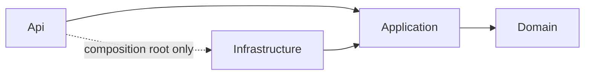

# Backend layers and slices

Follows the `clean-slice-dotnet-service` skill (`C:\skills`).

| Project (`src/Manti3.Backend/`) | Holds |
|---|---|
| `Manti3.Backend.Domain` | entities, no package references |
| `Manti3.Backend.Application` | `Features/<Area>/<UseCase>/`, `Result<T>`, handler abstractions, ports |
| `Manti3.Backend.Infrastructure` | `AppDbContext`, port implementations, health checks |
| `Manti3.Backend.Api` | endpoints (`IEndpoint`), `Program.cs`, ProblemDetails, CORS, Serilog |

## Decisions
- One use case = one folder = one handler = one endpoint class. Example: [Get Items](../api/get-items.md).
- Handlers are `internal sealed`, return `Result<T>`, and are decorated with validation and logging.
- Liveness checks the process only; the database is checked by readiness and startup.
- Layer rules are enforced by architecture tests in `tests/Manti3.Backend.UnitTests`.
- Packages are versioned centrally in the repository root `Directory.Packages.props`.
